<!--
AI-ASSISTED DRAFT. Generated with an AI assistant from this project's code and results.
Before submitting: check your institution's generative-AI policy, rewrite in your own words where the
policy requires it, verify every statement against the notebooks, fill in the [bracketed] fields,
and declare the assistance (docs/AI_use_declaration.md). Body word count target: <= 1500
(tables and captions excluded).
-->

# Remaining Useful Life Prediction for Turbofan Engines: CW1 Technical Record

**Module:** NB6057CEM Artificial Neural Networks  **Student:** K A D Dushara Kalubowila  **Student ID:** KIC-BSCCSAI-251P-052  **Word count:** 1,495 (including references; excluding tables, figures and captions)

Figures are in `results/figures/`; every number below comes from `results/` or the executed notebooks.

## T1 Problem definition and data preparation

**Problem and provenance.** The intended user is an aircraft-engine maintenance planner who must
schedule maintenance before failure without replacing parts early. The target is remaining useful life
(RUL) in cycles (regression); the unit of observation is one engine's most recent 30 cycles of sensor
readings.

Data come from NASA's C-MAPSS simulation (Saxena et al., 2008), released by NASA's
Prognostics Center of Excellence; data.gov lists it as a U.S. Government Work (public domain). Subset
FD001 has one operating condition and one fault mode: 100 run-to-failure training engines (20,631 rows)
and 100 truncated test engines with separately supplied true RUL. Being simulated, the data contain no
personal data; the main ethical risk is over-trust in a safety-critical setting, where late predictions
endanger lives.

**Data audit.** There are no missing values, duplicates or cycle gaps. Six constant sensors and
two-valued sensor 6 are dropped, leaving 14 of 21 sensors. Lifetimes span 128–362 cycles (Fig. 1), so elapsed
cycles cannot predict RUL; the shortest test engine (31 cycles) fits a 30-cycle window. Sensors drift
slowly, then accelerate near failure (Fig. 2), motivating piecewise-linear labels capped at 125 cycles
(Fig. 4). After windowing, 31.4% of targets sit at the cap (Fig. 5), so evaluation also examines
low-RUL behaviour.

**Leakage-safe pipeline.** Windows from one engine overlap, so I split *engines*, not rows: 80
training and 20 validation (seed 42, `data/splits/fd001_split.json`). Feature selection and min-max
scaling are fitted on training engines only (`models/preprocess_fd001.json`); the cycle counter is never
an input; no augmentation is used. **Correction:** during the reported runs the shared loader also read
the test files, including labels; they were never used for fitting or selection, but this was not
enforced. The loader is now split, the rebuilt training and validation arrays are byte-identical, and only
`scripts/evaluate.py` reads test labels, after checking the hash manifest.

| Partition | Engines | Windows (30 × 14) |
|---|---|---|
| Train | 80 | 14,459 |
| Validation | 20 | 3,272 |
| Test (official) | 100 | 100 (last window per engine) |

## T2 Learning from first principles

A NumPy MLP (`src/numpy_mlp.py`) maps 28 inputs (per-sensor window mean and slope, standardised) through
32 ReLU units to a linear output, with ½·MSE loss on RUL/125 and 961 parameters. Each unit's weighted sum,
bias and nonlinearity loosely mirror synaptic weighting and firing, without spikes or biological learning.
Mini-batch gradient descent (learning rate 0.05, batch 64, early-stopping patience 20) reduced training
loss from 1.049 to 0.0054, stopping at epoch 57 and restoring epoch 37 (validation RMSE 12.99; Fig. 6).

Analytical gradients were compared with central finite differences (ε = 1e-5, batch of 8) for 10
entries (Table 1). The smallest pre-activation magnitude (0.0067) far exceeded
any perturbation's effect (2.4e-5), so no ReLU kink was crossed. All errors (Table 1) are within a 1e-6 tolerance justified by O(ε²) truncation and float64 rounding.

*Table 1. Gradient check: analytical vs central-difference gradients (10 entries).*

| Parameter | Entries | Max absolute error | Max relative error |
|---|---|---|---|
| W1 | 4 | 4.6e-12 | 1.3e-10 |
| b1 | 2 | 1.2e-12 | 4.3e-12 |
| W2 | 3 | 4.3e-12 | 9.3e-12 |
| b2 | 1 | 2.2e-12 | 1.8e-12 |

As a check, the network overfitted 16 examples (loss 0.907 → 4.3e-5 in 3000 epochs). In a
learning-rate sweep, 0.005 converged slowly and 0.5 diverged in epoch 1, flagged as `diverged` (Fig. 8). Without standardisation, validation RMSE was 20.45: slopes were about 100× smaller
than means and effectively ignored.

## T3 Baseline and framework models

**Baseline.** A random forest (Breiman, 2001; 300 trees) on 56 window features (mean, slope, last value and standard
deviation per sensor), trained on the same windows and evaluated with the same metric.

| Model | Architecture (input 30 × 14) | Parameters |
|---|---|---|
| Window MLP | Flatten 420 → Linear 128 → ReLU → Dropout → Linear 64 → ReLU → Dropout → Linear 1 | 62,209 |
| LSTM | 2-layer LSTM (64 units) → last time step → Dropout → Linear 1 | 53,825 |

Both networks have two hidden layers, similar capacity and the same 30-cycle input. The MLP gives each
cycle-and-sensor position its own weights, so it can use order within the window but shares nothing
across time and keeps no state; the LSTM (Hochreiter and Schmidhuber, 1997) reuses recurrent weights at each step and carries a gated state.
The scaled target is bounded in [0, 1], but both use an unconstrained linear output with MSE loss (a
bounded output was not tested; negative predictions are clipped at inference). The MLP uses ReLU with
Kaiming initialisation; the LSTM uses sigmoid gates and tanh activations with PyTorch defaults. Both use
Adam (Kingma and Ba, 2015; learning rate 1e-3, weight decay 1e-5, batch 256) and validation early stopping (patience 10),
saving the best weights per seed (Fig. 9).

**Fair comparison.** Before any tuning I fixed a budget in `configs/tuning_plan.json`: four candidates
per network (width × dropout) and three for the forest, each run with seed 0 and selected on validation
RMSE. All 11 trials are reported (`results/metrics/tuning.json`); winners are frozen as
`configs/final_*.json`.

**Traceability.** Preparation (`src/data.py`), training (`src/train_torch.py`, `scripts/train_*.py`)
and evaluation (`scripts/evaluate.py`) are separate. Each metrics file records configuration, seed,
library versions, platform and threads. All runs used CPU PyTorch 2.14.1 (Python 3.12.3, Linux). No
pretrained weights or borrowed code were used. Re-running all 11 tuning trials reproduced every score
exactly (`results/metrics/tuning_rerun_check.txt`).

## T4 Experiments and evaluation

**Repeated evaluation.** Each final model was trained with seeds 0–2 on the fixed split; Table 2 links
every run to its configuration, seed, validation score and test score.

| Model | Val RMSE | Test RMSE | Test MAE | PHM08 score |
|---|---|---|---|---|
| Random forest | 12.79 ± 0.03 | **12.13 ± 0.13** | 8.98 ± 0.07 | 226 ± 6 |
| Window MLP | 12.81 ± 0.02 | 13.40 ± 0.44 | 10.05 ± 0.27 | 281 ± 18 |
| LSTM | 12.83 ± 0.11 | 13.27 ± 0.43 | 9.81 ± 0.34 | 280 ± 18 |

*Table 2. Individual runs; `results/results_table.csv` also lists each checkpoint, MAE and score.*

| Model | Configuration | Seed | Val RMSE | Test RMSE |
|---|---|---|---|---|
| Random forest | `configs/final_random_forest.json` | 0 | 12.82 | 12.25 |
| Random forest | `configs/final_random_forest.json` | 1 | 12.76 | 11.99 |
| Random forest | `configs/final_random_forest.json` | 2 | 12.77 | 12.13 |
| Window MLP | `configs/final_mlp.json` | 0 | 12.79 | 13.55 |
| Window MLP | `configs/final_mlp.json` | 1 | 12.82 | 13.74 |
| Window MLP | `configs/final_mlp.json` | 2 | 12.82 | 12.90 |
| LSTM | `configs/final_lstm.json` | 0 | 12.94 | 13.36 |
| LSTM | `configs/final_lstm.json` | 1 | 12.73 | 13.64 |
| LSTM | `configs/final_lstm.json` | 2 | 12.81 | 12.80 |

RMSE (cycles, penalising large errors) is primary; MAE gives typical error and the PHM08 score (Saxena et al., 2008)
penalises dangerous late predictions. The models were indistinguishable on 20 validation engines, but on
100 test engines the forest was about 1.2 cycles better with a third of the networks' seed spread. The LSTM's 0.13-cycle edge over the MLP (13.27 vs 13.40) is far smaller than either
seed standard deviation (about 0.43), so no advantage is established. All models are accurate below
about 40 cycles; at 50–100 cycles most residuals are late (Fig. 10); time-ordered predictions track the
last 50 cycles closely (Fig. 11).

**Ablation.** Setting the MLP's dropout from 0.1 to 0 lowered validation RMSE in all three seeds (12.81
→ 12.67), so the claim that dropout helps is not supported. Remaining confounders are the overlapping
effect of early stopping and weight decay, single-seed selection of dropout, and only 20 validation
engines. The final configuration was kept.

**Errors and robustness.** Near-median errors are about ±7 cycles. The five largest errors (Fig. 12)
fall into two patterns. Engines 93, 45 and 3 were predicted early, possibly because their sensors degraded
before the labelled knee. Engines 67 and 50 were predicted about 30 cycles late; with only 71–74 observed
cycles, this may reflect limited degradation information.

Both stress tests were fixed in advance in `configs/evaluation_protocol.json`. In the history-length
subgroups (n = 50 each), every model is worse on short histories, with the LSTM the most affected
(14.34 vs 12.09). Under Gaussian noise added to the scaled inputs (Fig. 13), the forest leads up to
σ = 0.02 but degrades fastest (24.9 at σ = 0.10, against 18.3 for the MLP and 20.1 for the LSTM).
Synthetic noise is not a real sensor fault; this shows relative sensitivity only.

## T5 Recommendation and use

*Table 3. Inference time: median of 50 calls after 5 warm-ups on an Intel Core i5-12450HX CPU (12 logical cores); PyTorch default 8 threads; forest `n_jobs=-1`, including thread start-up.*

| Model | Test RMSE | Size | ms/engine (batch 1) | ms/100 engines |
|---|---|---|---|---|
| Random forest | 12.13 | 373,148 tree nodes | 55.7 | 75.1 |
| Window MLP | 13.40 | 62,209 parameters | 0.21 | 1.99 |
| LSTM | 13.27 | 53,825 parameters | 0.62 | 3.33 |

I recommend the random forest for clean FD001-like data. It is the most accurate and most stable model,
and its latency is ample for decisions made once per cycle. Where inputs may be noisier than the benchmark, the window MLP is preferable: it is the most
robust to noise and the cheapest to run. At three times the MLP's inference time, the LSTM shows no established advantage, so recurrence is not shown to help on FD001.

`scripts/predict.py` loads the saved preprocessing and three seed checkpoints and validates input. For
test engine 31 it predicts 11 cycles (true: 8) and advises immediate maintenance. It rejects empty files,
negative cycle numbers, a 20-cycle history and a missing sensor (exit code 2), and refuses an FD002
engine as out of scope (exit code 3).

**Exploratory follow-up.** Two later experiments were designed after these test results were known and
reuse the same test set, so they are descriptive only (`experiments/`, notebooks 04–05):

| Follow-up (3 seeds) | Inputs | Test RMSE |
|---|---|---|
| v1 neural upgrade (MLP) | 140 pooled window features | 12.69 ± 0.20 |
| v2 history MLP | 113 whole-history features | 9.75 ± 0.43 |
| v2 history forest (comparator) | same history features + ordered pooled-window means (197) | 10.93 ± 0.10 |

V2 adds history (initial levels, trends), so its gain mixes information and architecture in
unmeasured shares; confirming it needs new data. The recommendation above is unchanged.

**Limitations.** The data are simulated, cover one operating condition and one fault mode, and the test
set has 100 engines. Predictions for short histories are late. The cap at 125 cycles is an assumption,
and RMSE against uncapped truth is higher (13.4–14.9). These results do not establish readiness for
deployment. A feasible next experiment is FD004 (six operating conditions, two fault modes) with
condition-wise normalisation.

## T6 Reproducibility

The README lists setup, run and smoke-test commands (`python scripts/smoke_test.py`, about 7 s).
Dependencies are pinned in `requirements.txt`. The raw data are fetched by `scripts/download_data.py`
and not redistributed. Splits, seeds, configurations, checkpoints and metrics are included. Follow-up models run with `scripts/predict_neural_history.py`. Demonstration video: <https://drive.google.com/drive/folders/1sSR8g8CIEi_t4GLRz3SaDFI6rsfcLA5K?usp=sharing>. Source code: <https://github.com/DusharaDT3/cmapss-rul>.

## Appendix: figures

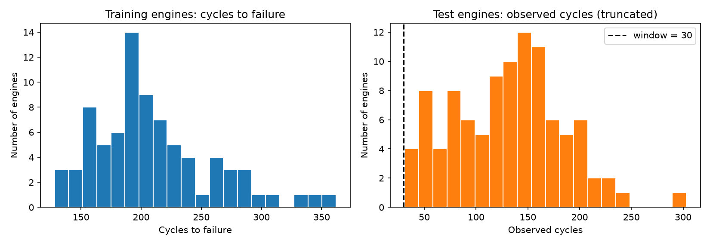

*Fig. 1. Training-engine lifetimes and observed test-engine lengths, with the 30-cycle window.*

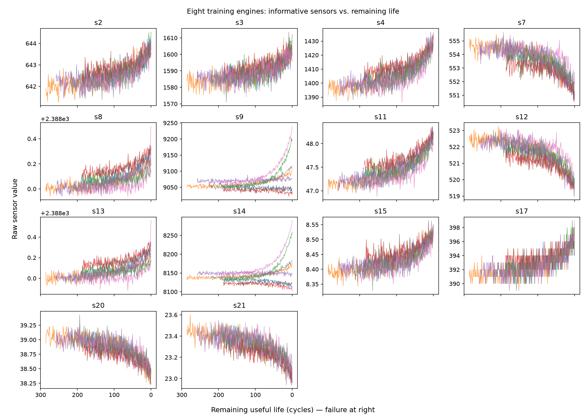

*Fig. 2. The 14 retained sensors against remaining life for eight training engines.*

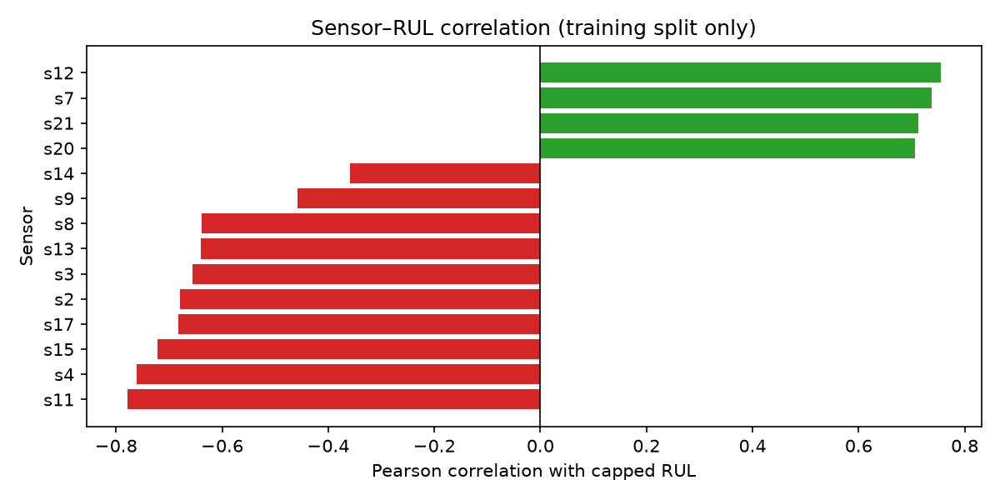

*Fig. 3. Pearson correlation of each sensor with capped RUL (training split).*

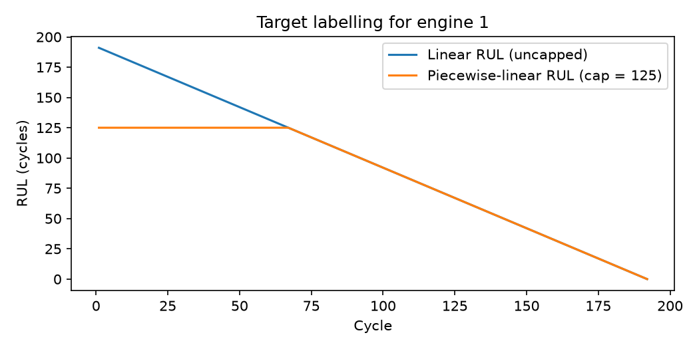

*Fig. 4. Linear vs piecewise-linear (capped at 125) RUL target.*

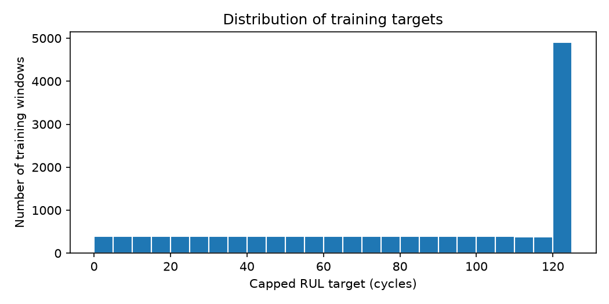

*Fig. 5. Distribution of capped training targets after windowing.*

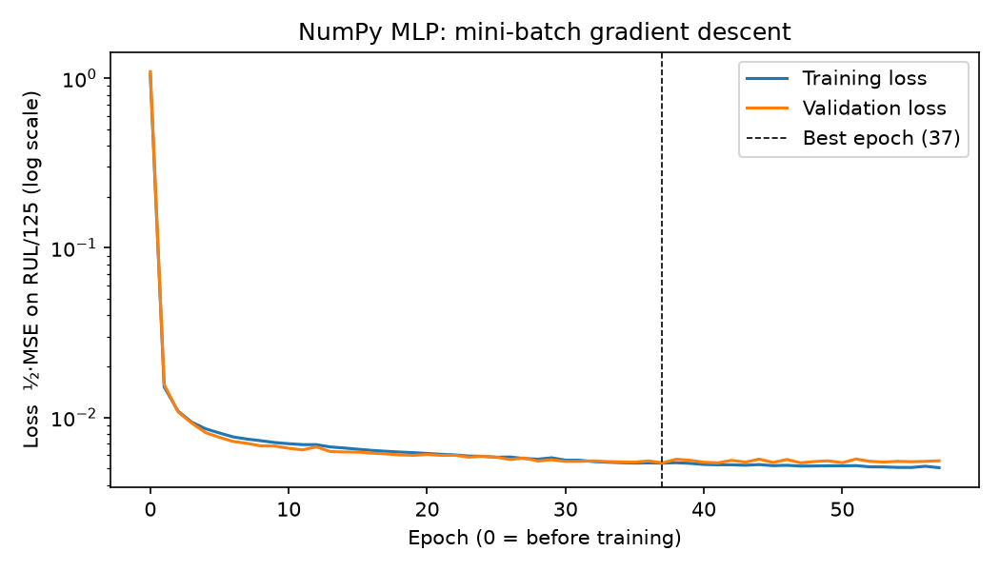

*Fig. 6. NumPy MLP training and validation loss; dashed line marks the restored epoch.*

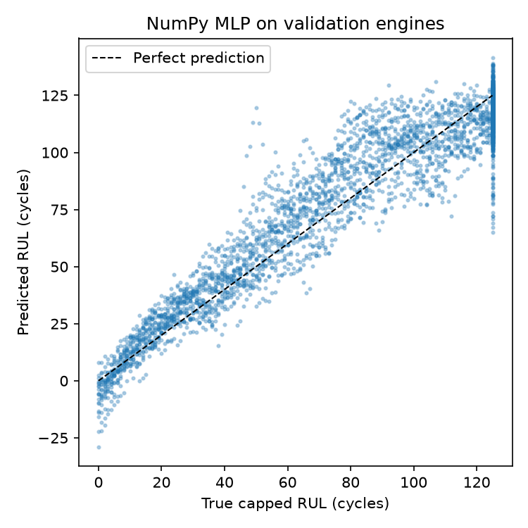

*Fig. 7. NumPy MLP predictions on validation engines.*

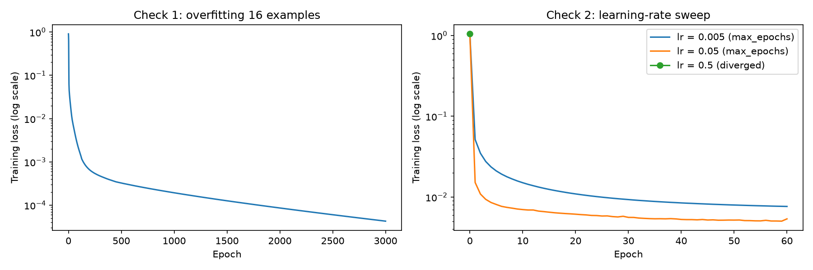

*Fig. 8. Tiny-batch overfitting check and learning-rate sweep.*

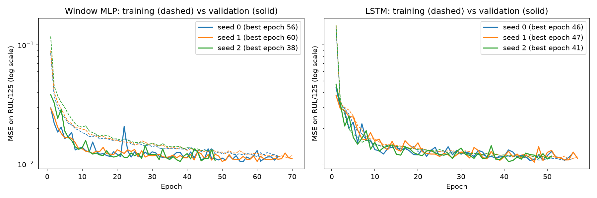

*Fig. 9. Training (dashed) and validation (solid) loss for both networks, three seeds.*

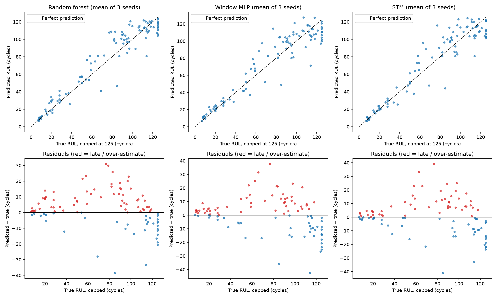

*Fig. 10. Test predictions vs capped truth (top) and residuals (bottom; red = late).*

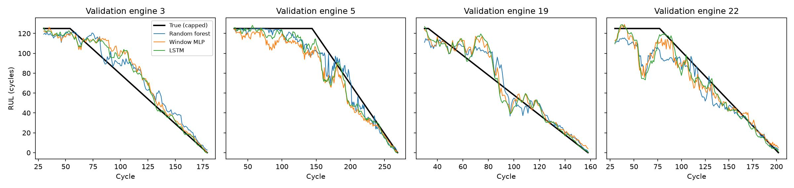

*Fig. 11. Time-ordered predictions on four validation engines.*

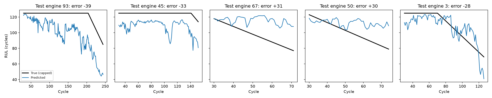

*Fig. 12. The five largest random-forest test errors over each engine's observed history.*

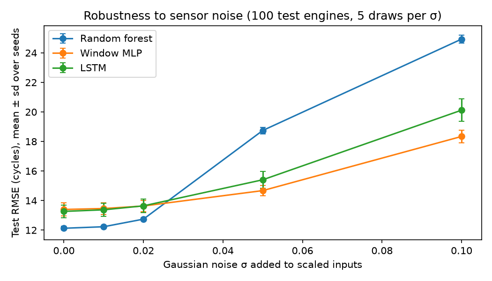

*Fig. 13. Test RMSE under Gaussian input noise (mean ± sd over seeds).*

## References
Breiman, L. (2001) 'Random forests', *Machine Learning*, 45(1), pp. 5–32.

Hochreiter, S. and Schmidhuber, J. (1997) 'Long short-term memory', *Neural Computation*, 9(8),
pp. 1735–1780.

Kingma, D.P. and Ba, J. (2015) 'Adam: a method for stochastic optimization', *International Conference on Learning Representations (ICLR)*, San Diego, CA.

Saxena, A., Goebel, K., Simon, D. and Eklund, N. (2008) 'Damage propagation modeling for aircraft engine
run-to-failure simulation', *International Conference on Prognostics and Health Management (PHM 2008)*,
Denver, CO, 6–9 October. IEEE.
