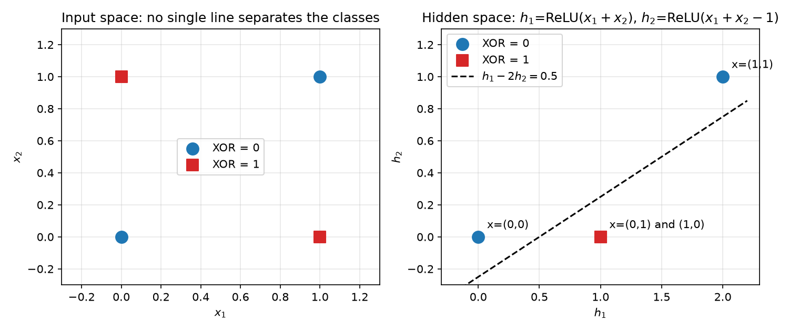
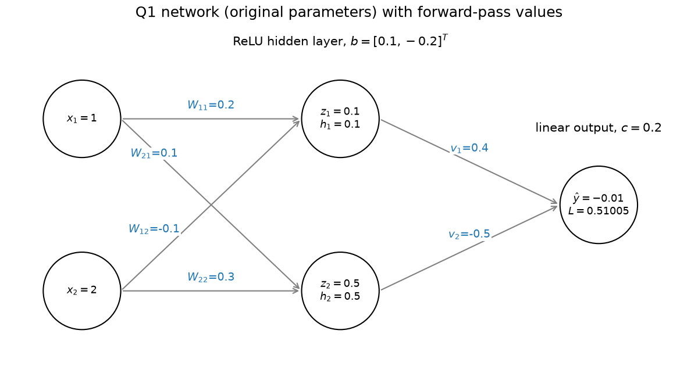

<!--
AI-ASSISTED DRAFT. Generated with an AI assistant from this project's results.
Before submitting: check your institution's generative-AI policy, rewrite in your own words where the
policy requires it, read every cited source yourself. Verification status: Liu et al. (2025) was read in full
(open access); every claim about Ensarioğlu et al. (2023) and Mo et al. (2021) matches their abstracts
(university repository and RePEc), but their full texts were not accessible, so read them through your
library before submission; redo the Q1 calculation by hand, fill in the [bracketed]
fields, and declare the assistance (docs/AI_use_declaration.md). Target: ~2500 words, excluding
references, equations, tables and appendices.
-->

NB6057CEM Artificial Neural Networks BSc Computer Science with AI <i>CW2 Theory Coursework: Individual Analytical Report</i>

<h1 align="center" style="font-size:20pt; margin-top:2cm; margin-bottom:2cm">Neural Network Principles and Critical Analysis, Applied to Turbofan RUL Prediction</h1>

<b>Project title:</b> Remaining useful life prediction for turbofan engines (NASA C-MAPSS FD001) <b>Student name:</b> K A D Dushara Kalubowila <b>Student ID:</b> KIC-BSCCSAI-251P-052 <b>Word count:</b> 2,620 (excluding title page, references, equations, tables, figures and captions) <b>Date:</b> November 2026

CW1 figures (Fig. 1–13) and tables are cited from the CW1 technical record.

## Q1 Fundamentals and numerical backpropagation

### (a) Foundations

An artificial neuron is loosely modelled on a biological one: inputs (dendrites) are scaled by weights
(synaptic strengths), summed together with a bias (a firing threshold), and passed through a
nonlinearity (the firing response). The analogy has clear limits. First, biological neurons
communicate with discrete, timed spikes, so information can sit in spike timing; an MLP unit outputs
one real number with no time dimension (Maass, 1997). Second, there is no established biological
mechanism that sends exact error derivatives backwards through the same synapses, as backpropagation
requires (Rumelhart, Hinton and Williams, 1986). Brains appear to rely on local, often unsupervised
plasticity.

A single-layer perceptron computes a thresholded weighted sum, so its decision boundary is the
hyperplane **w**ᵀ**x** + b = 0. XOR puts (0,1) and (1,0) in class 1 and (0,0) and (1,1) in class 0. Because the
classes lie on opposite diagonals, no single line can separate them (Minsky and Papert, 1969; Fig. Q1a,
left).

An MLP adds a hidden layer that re-maps the inputs before the output. With h₁ = ReLU(x₁+x₂) and
h₂ = ReLU(x₁+x₂−1), the four inputs map to (0,0), (1,0), (1,0) and (2,1). The output ŷ = h₁ − 2h₂ is
then 0, 1, 1 and 0, so a linear threshold in hidden space separates the classes (Fig. Q1a, right). In
general, nonlinear hidden units let the network compose piecewise-linear regions, so representational
capacity grows with width and depth instead of staying limited to one hyperplane.

### (b) Forward pass

With x = [1, 2]ᵀ, y = 1 and the given parameters (Fig. Q1b):

- z₁ = 0.2(1) − 0.1(2) + 0.1 = **0.1**  z₂ = 0.1(1) + 0.3(2) − 0.2 = **0.5**
- h₁ = ReLU(0.1) = **0.1**  h₂ = ReLU(0.5) = **0.5** (both units active)
- ŷ = 0.4(0.1) − 0.5(0.5) + 0.2 = **−0.01**
- Prediction error ŷ − y = **−1.01** (signed, in output units); loss L = ½(−1.01)² = **0.51005**
  (a non-negative scalar that training minimises).

### (c) Backward pass and update

Write e = ∂L/∂ŷ = ŷ − y = −1.01.

- Output layer: ∂L/∂vⱼ = e·hⱼ, so ∂L/∂v = [−0.101, −0.505]; ∂L/∂c = e = −1.01.
- Hidden error signals: δⱼ = ∂L/∂zⱼ = e · vⱼ · ReLU′(zⱼ), with ReLU′ = 1 for both units, so
  δ₁ = −1.01 × 0.4 × 1 = **−0.404** and δ₂ = −1.01 × (−0.5) × 1 = **0.505**.
- Hidden layer: ∂L/∂Wⱼₖ = δⱼ xₖ and ∂L/∂bⱼ = δⱼ:

| | ∂L/∂Wⱼ₁ | ∂L/∂Wⱼ₂ | ∂L/∂bⱼ |
|---|---|---|---|
| unit 1 | −0.404 | −0.808 | −0.404 |
| unit 2 | 0.505 | 1.010 | 0.505 |

Simultaneous update θ ← θ − 0.1·∂L/∂θ, with every gradient evaluated at the original parameters:

- W = [[0.2404, −0.0192], [0.0495, 0.1990]]; b = [0.1404, −0.2505]ᵀ
- v = [0.4101, −0.4495]ᵀ; c = 0.301

Recomputing: z = [0.3424, 0.1970], both units still active, so ŷ = 0.4101(0.3424) − 0.4495(0.1970) +
0.301 = **0.3529**, and L = ½(0.3529 − 1)² = **0.2094**. The loss falls by 59%.

A hidden unit's error signal has three factors: the output error e (how wrong the network is), the
outgoing weight vⱼ (how much this unit influenced the output), and the local derivative ReLU′(zⱼ)
(whether the unit was active and so could pass gradient). Computing gradients backwards does not make
the network recurrent. Recurrence means a unit's state at one time step feeds the next input's
computation. Here, information flows only forwards at inference time, and the backward pass is the
chain rule applied to one fixed feed-forward graph during training.

### (d) Interpretation

One step lowers the loss on one example only; a larger step could overshoot (my CW1 sweep diverged at
learning rate 0.5; Fig. 8). Convergence needs repeated updates over all training data, and
generalisation must be measured on held-out data. A suitable stopping criterion is validation early
stopping: stop after a set number of epochs without improvement and restore the best weights (CW1
patience 10; Fig. 9).

---

## Q2 Comparing architectures and learning approaches

### (a) Architecture comparison

| | MLP | RBF network | Kohonen SOM | Elman RNN | Spiking NN |
|---|---|---|---|---|---|
| **Representation** | Distributed real-valued activations | Localised: each unit responds near its centre (Gaussian of distance) | Position of the winning node on a 2-D lattice | Hidden activations plus a copy of the previous hidden state | Discrete spikes; information in rates or timing |
| **Connectivity / state** | Feed-forward, stateless | Feed-forward, one hidden layer, stateless | Input fully connected to the lattice; neighbourhood topology | Recurrent context layer gives **temporal state** | Recurrent or feed-forward; membrane potential is internal state |
| **Learning** | Backpropagation + gradient descent | Centres often by clustering, then linear least squares for output weights | Competitive learning with neighbourhood update | Backpropagation through time (or truncated) | Varies: STDP (local, unsupervised), surrogate-gradient training, or ANN-to-SNN conversion |
| **Supervision** | Supervised | Usually supervised (output layer) | Unsupervised | Supervised | Either |
| **Suitable application** | Static tabular prediction | Smooth low-dimensional function approximation | Visualising and clustering high-dimensional data | Short sequences, e.g. sensor streams | Low-power event-based sensing on neuromorphic hardware |
| **Limitation** | Fixed input size; no memory beyond its input; needs labels | Number of units grows quickly with input dimension | No class output; results depend on map size and schedule | Vanishing gradients over long sequences | Non-differentiable spikes make training hard; tooling is immature |

Two distinctions matter. An Elman network's temporal *state* is architectural: the context layer
stores the previous hidden activations (Elman, 1990). *Backpropagation through time* is merely the
training algorithm that unrolls this recurrence. Spiking networks have no single learning rule. STDP is local and unsupervised,
while surrogate-gradient methods replace the spike's derivative so that backpropagation can be applied
(Neftci, Mostafa and Zenke, 2019).

### (b) Learning paradigms

MLP backpropagation is supervised. It minimises a loss between predictions and labels, such as MSE on
RUL in CW1, so every training example needs a target, and performance is judged by error on held-out
labelled data. A SOM uses unsupervised competitive learning (Kohonen, 1990). For each input, the node
whose weight vector is nearest wins, and it and its lattice neighbours move towards the input. The
objective is implicit: low quantisation error with topology preserved. It needs no labels, and it is
evaluated with quantisation error, topographic error, or how well clusters match known structure.

A SOM cluster identifier is not a class prediction. A node is simply a region of input space. One class may span several nodes, and one node may mix classes. To
predict classes, nodes must be labelled afterwards (for example by majority vote of labelled
examples), which reintroduces supervision and should then be evaluated on held-out labels.

### (c) Applied judgement

For **static tabular prediction**, I recommend an MLP, alongside a tree ensemble as the baseline. Rows
have no inherent order, so a fixed-width feed-forward mapping fits. A recurrent network is unsuitable here: it would impose an
arbitrary order on features and add state with nothing to remember.

For **online sequential sensor analysis**, such as the simulated turbofan data in CW1 (Saxena et al.,
2008), temporal information is the signal. Degradation appears as
trends across cycles, not in any single reading (CW1 Fig. 2). A recurrent model such as an LSTM
(Hochreiter and Schmidhuber, 1997), or a windowed feed-forward model, is appropriate. A SOM or a static MLP fed one reading at a time is
unsuitable, because it discards the history that carries the degradation trend.

CW1 qualifies this recommendation. On FD001 the LSTM's mean test RMSE (13.27 ± 0.43) was slightly lower
than the window MLP's (13.40 ± 0.44), but the gap is far smaller than the seed variation, so the
advantage is not established; both were beaten by a random forest on window statistics (12.13 ± 0.13).
The window MLP is not blind to time: it sees all 30 cycles with position-specific weights, so it can
learn the trend inside the window. With smooth degradation and one operating condition, that was apparently
enough. Recurrence should help more when dependencies exceed the window or the dynamics change with
operating condition. *Later exploratory result:* after these
test results were known, a history MLP given each engine's whole observed history (initial levels and
trends) reached 9.75 ± 0.43 against 10.93 ± 0.10 for a forest given the same history plus pooled window means. The forest also
improved with history (12.13 → 10.93). With the test set reused, this suggests history helps; it does
not overturn the original comparison.

---

## Q3 Justifying the practical design and interpreting evidence

### (a) Design argument

Both CW1 networks predict RUL/125 with a **linear output and MSE loss**. The target is bounded (scaled
RUL lies in [0, 1]), but a linear output does not enforce this, so some predictions fell below 0 and are
clipped at inference. A scaled sigmoid would enforce the bounds but its gradient shrinks at both ends,
where many targets lie (31% at the cap); it was not tested, so the linear output is a simplicity choice,
not a demonstrated optimum. MSE matches a Gaussian error assumption and the primary RMSE metric. In the MLP, **ReLU hidden units** with **Kaiming initialisation** are
designed to keep pre-activation variance roughly constant across layers, so that gradients neither vanish
nor explode initially (gradient norms were not measured). The LSTM does not use ReLU: its **sigmoid gates and tanh cell activations** control
an additive cell-state path intended to ease the vanishing gradients of a plain Elman network over 30 steps; CW1 shows
stable training, not that this mechanism caused it.

**Depth and width** were set by the pre-registered search. Two hidden layers satisfy the brief. The
wider MLP (141k parameters) was worse (13.21 vs 12.80) and early-stopped sooner (27–28 epochs), which
suggests that the extra capacity fitted noise and not degradation. **Adam** with weight decay 1e-5 was
used for both networks, keeping the optimiser identical. The learning curves (Fig. 9)
show training and validation losses converging together, at about 0.011, with no late divergence, suggesting
adequate regularisation.

The ablation challenges one choice: removing dropout improved validation RMSE in every seed (12.81 →
12.67). A likely explanation, not tested here, is that with early stopping and weight decay already present,
dropout mainly added gradient noise to a model that was not overfitting. The stress test (Fig. 13) shows the networks' strength: under input
noise they degraded far more slowly than the forest (MLP 18.3 vs forest 24.9 at σ = 0.10). A plausible explanation,
not tested here, is that the networks' outputs depend on weighted combinations across all 30 cycles,
while the forest splits on features such as the window's standard deviation, which noise corrupts directly. My T2 result also
showed how sensitive gradient descent is to input scale: unstandardised slope features left validation
RMSE at 20.45 against 12.99.

### (b) Experimental validity

Engines were split into partitions as whole units, so overlapping windows never crossed partitions.
Preprocessing was fitted on training engines only, and test metrics were computed once, after a hash
manifest froze every configuration and checkpoint. One weakness was found on review: the shared loader
also read the test files, including labels, whenever training data were loaded. The labels were never
used for fitting or selection, but "test labels unseen until evaluation" was not enforced in code. The
loader is now separated, with byte-identical training and validation arrays, and the evaluation script
refuses to run if the frozen files change. The tuning budget and candidates were fixed
before any trial, every trial is reported, and selection used validation RMSE only. Three seeds per configuration exposed
training variability. The primary metric, RMSE, was justified against MAE and the asymmetric PHM08
score, which matters because late predictions are the costly ones.

Four threats to validity remain:

1. **Small validation set.** With 20 engines, all three models scored 12.79–12.83 on validation but
   differed by about 1.2 cycles on test. Validation could not discriminate between them.
2. **Single-seed tuning.** Candidates were compared on seed 0 only, yet the seed-to-seed test spread for
   the networks (±0.44) exceeds some candidate differences. Selected hyperparameters may therefore be
   noise-driven; as the networks vary more between seeds than the forest (±0.13), this may bias the comparison against them.
3. **Target definition.** The cap at 125 was assumed, not tuned. RMSE against uncapped truth is higher
   for every model (13.4–14.9), so the conclusions hold only for the capped target.
4. **Unequal representations and budgets.** The forest received hand-crafted window statistics and had
   no early stopping, whereas the networks learned from raw windows. Part of the gap may reflect the
   features rather than the learners.

### (c) Framework limitations

PyTorch's automatic differentiation (Paszke et al., 2019) removed T2's manual gradient work but hides
how gradients are computed. In T2 a wrong transpose would have shown up in the gradient check
(maximum relative error 1.3e-10); in PyTorch the same kind of bug, such as an accidental broadcast in
a loss, can train without error. Reproducibility needed explicit seeds for Python, NumPy and PyTorch,
plus a seeded batch generator. With those, re-running all 11 tuning trials reproduced every score
exactly. I used the CPU because cuDNN's recurrent kernels can be nondeterministic on a
GPU, and the 4 GB RTX 2050 offered little speed-up for 54k-parameter models.

Deployment constraints differ sharply. The scikit-learn forest (Pedregosa et al., 2011) has 373,148
tree nodes, a 27 MB checkpoint and 55.7 ms latency per engine; the MLP has a 0.25 MB checkpoint and
0.21 ms latency, so it is far cheaper for edge use despite lower clean-data accuracy.

---

## Q4 Critically evaluating neural network developments

### (a) Evidence-based comparison

**Development 1: hybrid CNN-RNN models (modular).** These systems use a convolutional front end to
extract local patterns from each window and a recurrent back end to model how those patterns evolve.
Early work established each component for RUL separately: Babu, Zhao and Li (2016) used a deep CNN
regressor, Zheng et al. (2017) an LSTM, and Li, Ding and Sun (2018) a deeper 1D CNN on normalised raw
windows, each evaluated on C-MAPSS. More recently, Ensarioğlu, İnkaya and Emel (2023) combined a
1D-CNN-LSTM with change-point-based labelling and difference features. On FD001 they report an RMSE of
16.1 and a score of 437.2.

Their labelling and features differ from mine, so their RMSE
cannot be compared directly with my 12–13. The contribution is the modular split between local feature
extraction and temporal aggregation. The main limitation is that the gains are tied to preprocessing
and labelling choices that vary between papers. For my project, the hybrid is only worth adding if the
temporal model has something to aggregate. On FD001 the LSTM's 0.13-cycle edge over the window MLP
was within seed variation, so there is no clear evidence that it did.

**Development 2: attention-based models.** Transformers replace recurrence with self-attention, so every
time step can attend directly to every other (Vaswani et al., 2017). Mo et al. (2021) applied a
Transformer encoder to RUL and added a gated convolutional unit. Their argument was that attention
alone is insensitive to local context, and they report performance superior or comparable to existing
methods on C-MAPSS. Attention's contribution is a direct path between distant time steps, avoiding the
LSTM's sequential bottleneck. Its limitations are that the cost grows quadratically with sequence
length, more data are needed, and, as Mo et al. conclude, local structure must be
reintroduced, making the model a hybrid. With 30-cycle windows and 80 training engines, my
project offers little of the long-range structure that attention is designed to exploit.

### (b) Proposed extension

I propose a **mixture of experts routed by operating condition** for the harder FD004 subset, which has
six operating conditions and two fault modes. The design follows the sparsely gated mixture of experts
of Shazeer et al. (2017). Liu, Xu and Geng (2025) showed a related design for multi-condition RUL: one
encoder per operating condition, soft-weighted by a two-layer softmax gate, with an auxiliary
cross-entropy loss that supervises the gate using the known condition label, followed by a Transformer
layer. My proposal tests a simpler question: does a gate trained *without operating-condition labels* over CW1-style window MLPs,
with no Transformer, beat a matched single MLP on FD004?

- **Components.** A small gating MLP reads the three operational settings and outputs softmax weights
  over K = 6 experts. Each expert is a window MLP of the CW1 type that reads the 30 × 14 sensor window.
  The prediction is the gate-weighted sum of the experts' RUL outputs.
- **Training.** End to end with MSE on capped RUL, using Adam and early stopping, on the same
  engine-grouped split protocol as CW1.
- **Hypothesis (falsifiable).** Over three seeds, the mixture achieves lower mean test RMSE on FD004 than
  a single window MLP with the same total parameter count.
- **Fair comparator.** A single MLP with matched parameters, given the operational settings as extra
  inputs, with the same split, tuning budget, seeds and preprocessing.
- **Decision rule.** As a proposed rule of thumb, not a significance test, the hypothesis is supported if the mixture's mean RMSE is lower than the
  comparator's by more than one seed standard deviation, inconclusive if the difference is within one
  standard deviation (three seeds give weak evidence), and refuted if the mixture's mean RMSE is equal
  or higher. A second check: if the learned gate weights do not track operating condition, the claimed modular specialisation did not occur, and
  Liu et al.'s condition-supervised gate would be the next variant to test.

### (c) Critical synthesis

The main trade-off is **data requirements against accuracy**. Hybrid and attention models add
parameters and design choices that need more data and more tuning trials to use well. My CW1 evidence
shows the risk: with 80 training engines, a random forest on simple window statistics beat both neural
networks on clean test data. My exploratory follow-up (Q2(c)) reversed this with whole-history inputs, but it reused the test set and mixes information with architecture. Published improvements hold under their own protocols; my proposed
benefits are hypotheses until (b) is run. A newer architecture is not automatically better; whether it helps depends on whether the
data contain the structure it is built to exploit.

---

## References

*Datasets and software*

NASA Prognostics Center of Excellence. *Turbofan Engine Degradation Simulation Data Set (C-MAPSS)*.
NASA Open Data Portal (public access; U.S. Government Work). Available at:
https://data.nasa.gov/dataset/damage-propagation-modeling-for-aircraft-engine-run-to-failure-simulation (Accessed: 9 November 2026).

Paszke, A. et al. (2019) 'PyTorch: an imperative style, high-performance deep learning library',
*Advances in Neural Information Processing Systems*, 32.

Pedregosa, F. et al. (2011) 'Scikit-learn: machine learning in Python', *Journal of Machine Learning
Research*, 12, pp. 2825–2830.

*Literature*

Babu, G.S., Zhao, P. and Li, X.-L. (2016) 'Deep convolutional neural network based regression approach
for estimation of remaining useful life', in *Database Systems for Advanced Applications (DASFAA
2016)*, LNCS 9642. Cham: Springer, pp. 214–228. doi:10.1007/978-3-319-32025-0_14.

Elman, J.L. (1990) 'Finding structure in time', *Cognitive Science*, 14(2), pp. 179–211.

Ensarioğlu, K., İnkaya, T. and Emel, E. (2023) 'Remaining useful life estimation of turbofan engines
with deep learning using change-point detection based labeling and feature engineering', *Applied
Sciences*, 13(21), 11893. doi:10.3390/app132111893.

Hochreiter, S. and Schmidhuber, J. (1997) 'Long short-term memory', *Neural Computation*, 9(8),
pp. 1735–1780.

Kohonen, T. (1990) 'The self-organizing map', *Proceedings of the IEEE*, 78(9), pp. 1464–1480.

Li, X., Ding, Q. and Sun, J.-Q. (2018) 'Remaining useful life estimation in prognostics using deep
convolution neural networks', *Reliability Engineering & System Safety*, 172, pp. 1–11.
doi:10.1016/j.ress.2017.11.021.

Liu, Y., Xu, B. and Geng, Y. (2025) 'Multi-condition remaining useful life prediction based on mixture
of encoders', *Entropy*, 27(1), 79. doi:10.3390/e27010079.

Maass, W. (1997) 'Networks of spiking neurons: the third generation of neural network models', *Neural
Networks*, 10(9), pp. 1659–1671.

Minsky, M. and Papert, S. (1969) *Perceptrons: An Introduction to Computational Geometry*. Cambridge,
MA: MIT Press.

Mo, Y., Wu, Q., Li, X. and Huang, B. (2021) 'Remaining useful life estimation via transformer encoder
enhanced by a gated convolutional unit', *Journal of Intelligent Manufacturing*, 32(7), pp. 1997–2006.
doi:10.1007/s10845-021-01750-x.

Neftci, E.O., Mostafa, H. and Zenke, F. (2019) 'Surrogate gradient learning in spiking neural
networks', *IEEE Signal Processing Magazine*, 36(6), pp. 51–63.

Rumelhart, D.E., Hinton, G.E. and Williams, R.J. (1986) 'Learning representations by back-propagating
errors', *Nature*, 323, pp. 533–536.

Saxena, A., Goebel, K., Simon, D. and Eklund, N. (2008) 'Damage propagation modeling for aircraft engine
run-to-failure simulation', *International Conference on Prognostics and Health Management (PHM
2008)*, Denver, CO. IEEE.

Shazeer, N. et al. (2017) 'Outrageously large neural networks: the sparsely-gated mixture-of-experts
layer', *International Conference on Learning Representations (ICLR)*.

Vaswani, A. et al. (2017) 'Attention is all you need', *Advances in Neural Information Processing
Systems*, 30.

Zheng, S., Ristovski, K., Farahat, A. and Gupta, C. (2017) 'Long short-term memory network for remaining
useful life estimation', *2017 IEEE International Conference on Prognostics and Health Management
(ICPHM)*, Dallas, TX, pp. 88–95.
